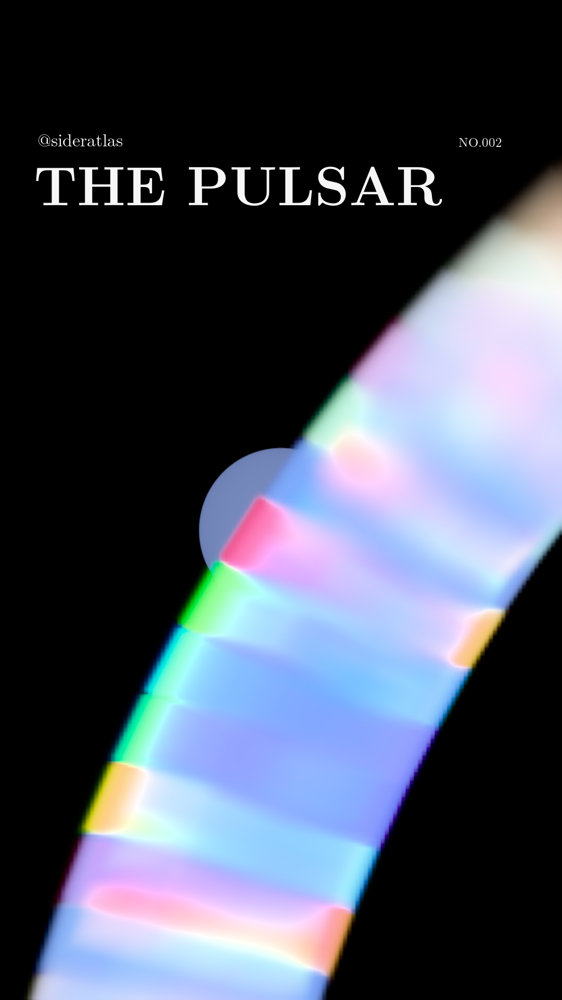

# @sideratlas · NO.002 · THE PULSAR

A calculated optical visualization of a plausible young rotation-powered pulsar, delivered as a full-frame 32-second Reel. Vela supplies physical reference scales; its luminosity, spectrum and pulse profile are not fitting targets

- [32-second Reel](media/optical/sideratlas-no002-optical-32s.mp4) — 1080 × 1920, 30 fps, SDR H.264
- [Instagram description (.text)](release/optical-v1/instagram-description.text)
- [Physical model, equations, assumptions and citations](release/optical-v1/MODEL-NOTES.md)
- [Parameter and energy-budget check](research/optical-finish/PHYSICAL-CONSISTENCY.md)
- [Release manifest and measured export](release/optical-v1/manifest.json)
- [Release downloads](https://github.com/Loganpis/sideratlas-pulsar/releases/tag/optical-v1.0.0)



The optical source uses guiding-centre particle transport, adiabatic focusing, radiative cooling and directional classical harmonic radiation in a prescribed near-zone dipole. A calculated magnetic hydrogen atmosphere supplies the stellar surface, with Schwarzschild light bending, gravitational shifts and local rotational Doppler effects. The model has explicit physical idealizations, including prescribed particle activation, an optically thin magnetosphere and a uniform approximate atmosphere

The native coupled PIC calculation is preserved as a separate numerical study. Its reduced particles are not rescaled into the optical emission. This release is a defensible approximate visualization, not a self-consistent global optical PIC solution or an observational reconstruction

The adopted particle power is comfortably below the rotational-power reference, and calculated radiation respects its injection budget. The atmosphere passes its numerical balance gates, with approximately 5% demonstrated depth sensitivity and unbounded omitted opacity effects. These limits and the source sampling remain documented; successful software checks do not establish observational validation

The image uses only `@sideratlas`, `THE PULSAR` and `NO.002`, Latin Modern type and a black background. One physical 89.37 ms rotation is slowed to eight seconds and repeated four times. A close diagonal crop and one fixed enhanced display exposure reveal the emission; optical brightness and color are calculated within the stated model, then tone-mapped for a screen

## Reproduce the Reel

Python 3.12, a fork-capable system and FFmpeg with the zscale filter are required. Install the Python dependencies, then fetch the exact large event archive from the release; its size and SHA-256 are checked before use. The small atmosphere table is included in Git. Exact tested package versions are recorded in [the release requirements](release/optical-v1/requirements-tested.txt)

```sh
python3 -m venv .venv
.venv/bin/python -m pip install -e '.[video,test]'
.venv/bin/python download_optical_assets.py
.venv/bin/python research/optical-finish/camera/render_parallel.py \
  --scene scene/optical/physical-pair-events.npz \
  --surface scene/optical/surface-intensity-si.npz \
  --output output/optical --width 1080 --bins 240 --fps 30 --repeats 4 \
  --workers 3 --meters-per-pixel 100 --roll -10 \
  --plasma-scale 8 --motion-arc-pixels 2 --exposure-reference surface
.venv/bin/python research/optical-finish/camera/verify_export.py \
  output/optical/sideratlas-no002-optical-32s.mp4
```

The original 5,271,172-event archive retains calculated spectral XYZ values and reconstructible source geometry. Smooth plasma radiance is integrated on a 135 × 240 physical raster and conservatively resampled onto the native 1080 × 1920 image; the stellar image is calculated at native scale. Sampling and display operations are recorded in the render receipt, with source/crop/arrival-energy ledgers

To calculate the photon archive locally instead of downloading it:

```sh
python research/optical-finish/particle-emission/run_component.py \
  --output output/photons --phases 256 --azimuths 128 --cooling 64 \
  --radii 5 --annuli 2 --wavelength-bins 64 --compact-camera
```

See [camera details](research/optical-finish/camera/README.md), [particle/radiation model](research/optical-finish/particle-emission/README.md), [atmosphere calculation](research/optical-finish/atmosphere/README.md) and [source repair](research/pic-source-repair/README.md) for separate reproduction and numerical scope

## Verification and history

The release software suite passes 268 tests. Eight inherited FITS checksum/datasum warnings concern the historical Fermi catalog snapshot; that snapshot is not the optical photon archive. Measured video properties and loop checks are recorded with the final media

The earlier GeV emission-map illustration remains available in [the original release notes](release/MODEL-NOTES.md) and historical media. The October research rebuild receipts remain preserved as dated records, including comparisons against Vela; those comparisons are not acceptance criteria for this generic visualization

## Credits and licensing

Full scientific sources and their roles are in the model notes. NASA / Goddard 2018 supplied visual research context; no NASA footage, code or music is used. Official CIE1931 data and font notices are preserved. Project code is GPL-2.0, dependency/data/font licenses retain their notices, and original media and caption are copyright Loganpis as stated in [NOTICE](NOTICE)
