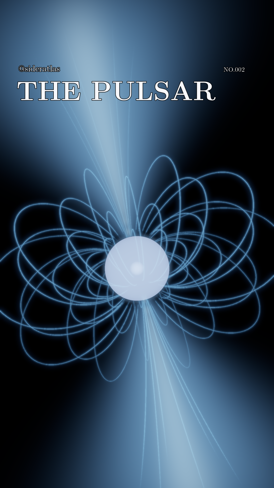

# @sideratlas · NO.002 · THE PULSAR

**New: [calculated gamma-ray photon Reel](https://github.com/Loganpis/sideratlas-pulsar/releases/tag/photon-v1.0.0)** — the original 0.1–100 GeV model rendered as outgoing photons, with a tiny central star, fixed external camera and the original delayed observer pulse. [Source and reproduction](photon-reel/README.md) · [Scientific notes](photon-reel/release/photon-v2/MODEL-NOTES.md) · [32-second video](https://github.com/Loganpis/sideratlas-pulsar/releases/download/photon-v1.0.0/sideratlas-002-pulsar-reel.mp4). This Vela-informed model remains approximate; the optical and conceptual 3D editions below are preserved

A cinematic 3D close view of a plausible young rotation-powered pulsar: a prominent neutron star, a rotating oblique magnetic field and paired radiation-direction envelopes explain the lighthouse effect. The star uses the existing approximate relativistic surface-radiation calculation. Luminous magnetic curves and beam envelopes are explicitly illustrative guides

- [32-second 3D Reel](media/pulsar-3d/sideratlas-no002-pulsar-3d-32s.mp4) — 1080 × 1920, 30 fps, SDR H.264
- [Instagram description (.text)](release/pulsar-3d-v1/instagram-description.text)
- [3D model, equations, assumptions and source roles](release/pulsar-3d-v1/MODEL-NOTES.md)
- [Current 3D production status](CURRENT-3D-STATUS.md)
- [Retained parameter and energy-budget check](research/optical-finish/PHYSICAL-CONSISTENCY.md)
- [Published releases](https://github.com/Loganpis/sideratlas-pulsar/releases)

The retained inputs are P = 89.37 ms, M = 1.4 M☉, R = 13 km, polar B = 3 × 10¹² G, T∞ = 0.70 MK and a 75° magnetic tilt. Vela supplies reference scales; its luminosity, spectrum and pulse shape are not fitting targets. The true geometric star-to-field scale is retained in this close view of the inner magnetosphere

The magnetic curves solve the prescribed near-zone dipole geometry, `r = L sin²θ`, and rotate about the spin axis. Selected closed curves and local polar segments reveal three-dimensional structure. Field lines are mathematical guides; their visibility, sampling, width and blue-white palette are presentation choices. The paired soft volumes show radiation directions sweeping with the magnetic axis. Their width is motivated by dipole tangents at a declared reference radius of 6R, with an assumed Gaussian profile and finite display length. They are not individual photon paths, particle tracks or a quantitative optical-emission prediction

The stellar image reuses the calculated approximate magnetic hydrogen atmosphere, Schwarzschild surface light bending and redshift, and local rotational Doppler effects. Field and beam guides use Euclidean projection, so this is a hybrid explanatory composition. Their brightness is independent of the enhanced stellar exposure. Full equations, numerical scope and omitted physics are documented in the model notes

Only `@sideratlas`, `THE PULSAR` and `NO.002` appear over the image, in Latin Modern type against black. One physical 89.37 ms rotation is slowed to eight seconds and repeated four times. A smooth periodic camera motion reveals depth. No new physical model run, global PIC solution or Vela reconstruction is claimed



## Reproduce the 3D Reel

Python 3.12, a fork-capable system (macOS or Linux), and FFmpeg with the zscale filter are required. The small surface-atmosphere table is included in Git. The renderer reuses that table and calculates its displayed surface image; it does not solve the atmosphere again

```sh
python3 -m venv .venv
.venv/bin/python -m pip install -e '.[video,test]'
OPENBLAS_NUM_THREADS=1 OMP_NUM_THREADS=1 \
  .venv/bin/python render_pulsar_3d.py --output outputs/pulsar-3d --width 1080
.venv/bin/python research/optical-finish/camera/verify_export.py \
  outputs/pulsar-3d/sideratlas-no002-pulsar-3d-32s.mp4 \
  --output outputs/pulsar-3d/export-verification.json
```

The output directory contains the eight-second loop, 32-second Reel, representative previews, a contact sheet and render metadata. Add `--preview-only` to generate the previews without encoding the movie. The published presentation copy is kept under `media/pulsar-3d/`; numerical and production receipts belong under `outputs/pulsar-3d/` and `release/pulsar-3d-v1/`

## Preserved optical observer and particle research

The earlier distant-observer optical edition remains available as a separate research view. It contains calculated guiding-centre particle transport, adiabatic focusing, radiative cooling, directional classical harmonic radiation, Lorentz transformations and photon arrival-time calculations in a prescribed physical dipole. Its plasma photon archive is not displayed as the luminous guide geometry of the 3D edition

- [Optical observer Reel](media/optical/sideratlas-no002-optical-32s.mp4)
- [Optical caption](release/optical-v1/instagram-description.text) and [complete optical model notes](release/optical-v1/MODEL-NOTES.md)
- [Optical release, exact large photon archive and measured delivery checks](https://github.com/Loganpis/sideratlas-pulsar/releases/tag/optical-v1.0.0)
- [Optical release manifest](release/optical-v1/manifest.json)

The optical edition's 5,271,172-event source, energy accounting and approximately 5% atmosphere depth sensitivity remain documented. Physical opacity omissions are not bounded by those numerical checks. Historical comparisons with Vela are preserved as research records and are not release criteria for this generic pulsar

To reproduce that historical optical view, fetch its checksum-pinned archive and use the original camera:

```sh
.venv/bin/python download_optical_assets.py
.venv/bin/python research/optical-finish/camera/render_parallel.py \
  --scene scene/optical/physical-pair-events.npz \
  --surface scene/optical/surface-intensity-si.npz \
  --output output/optical --width 1080 --bins 240 --fps 30 --repeats 4 \
  --workers 3 --meters-per-pixel 100 --roll -10 \
  --plasma-scale 8 --motion-arc-pixels 2 --exposure-reference surface
```

See [optical camera details](research/optical-finish/camera/README.md), [particle/radiation model](research/optical-finish/particle-emission/README.md), [atmosphere calculation](research/optical-finish/atmosphere/README.md) and [native conducting-source repair](research/pic-source-repair/README.md) for their separate reproduction and numerical scope

The native coupled PIC calculation is preserved as a separate numerical study. Its enlarged numerical star and reduced scales are not used for the physical geometry of the 3D Reel, and its numerical particles are not rescaled into optical photons. The earlier GeV emission-map illustration remains in [the original release notes](release/MODEL-NOTES.md) and historical media

## Verification and credits

The prior optical release passed 268 software checks and its measured export checks. The new geometry and retained surface-camera checks pass 18 tests. The delivered 3D video passes measured resolution, duration, color, frame-count and decoded repeated-cycle checks; [verification](release/pulsar-3d-v1/verification.json) and [current status](CURRENT-3D-STATUS.md) record the results. Software and encoding checks do not establish physical or observational validation

NASA / Goddard 2018 and 2008 supplied visual/context references. NASA's 2018 particle tracks are PIC diagnostics; this original rendering does not reproduce that PIC simulation. No NASA footage, simulation dataset, code or music is used. Full sources and roles appear in the model notes. Official CIE1931 data and font notices are preserved. Project code is GPL-2.0, dependency/data/font licenses retain their notices, and original media and caption are copyright Loganpis as stated in [NOTICE](NOTICE)
