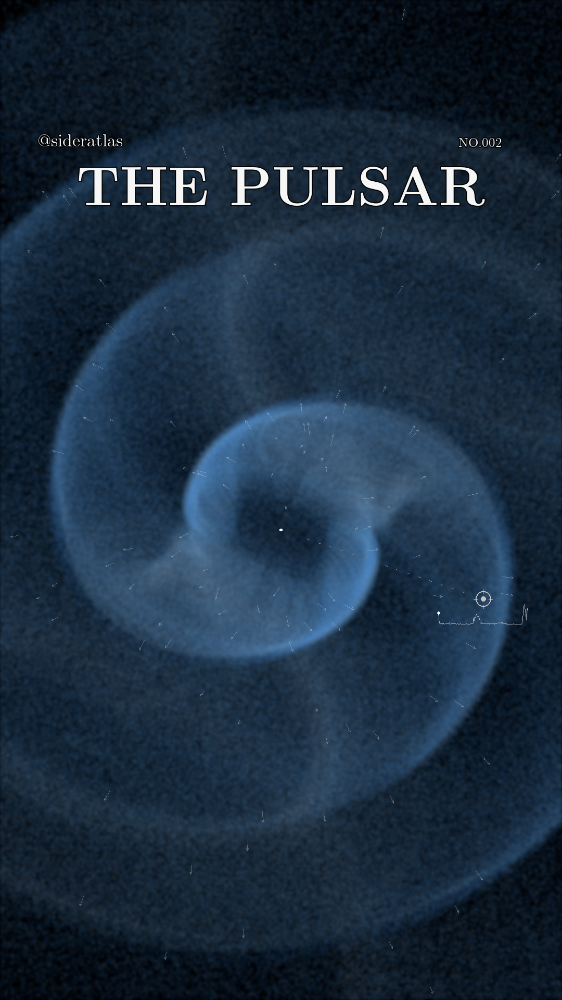

# Vela visible-light reconstruction — research rebuild

**The requested physical optical Reel is not yet available.** The previously released movie below is an approximate emission-map illustration, not a physical visible-light camera image

This branch adds a real CPU PIC foundation check, independently tested radiation and arrival-time kernels, atmosphere-input verification, CIE spectral color integration, and a full 1080 × 1920 camera specification. It does not claim a Vela production simulation or atmosphere fit

- [Current results and missing production inputs](release/optical-rebuild/README.md)
- [Measured native PIC benchmark](outputs/entity-pic-benchmark/verification.json)
- [Requested-format caption draft](release/optical-rebuild/instagram-description.draft.text)
- [Machine-readable production status](release/optical-rebuild/status.json)

## Previous v1 illustration

# @sideratlas · NO.002 · THE PULSAR

An original **Vela-informed scientific visualization**, presented as a 32-second, full-frame Instagram Reel. Calculated outer-magnetosphere curvature emission rotates across a black canvas, with only `@sideratlas`, `THE PULSAR` and `NO.002` over the image

- [32-second Reel](media/sideratlas-002-pulsar-reel.mp4) · 1080 × 1920 · 30 fps · H.264 / Rec.709
- [Poster](media/preview-00.png)
- [Instagram description (.text)](release/instagram-description.text)
- [Physical model, assumptions and full study credits](release/MODEL-NOTES.md)
- [Recorded scene](scene/scene.npz) · [Release file hashes](release-manifest.json)



The image projects this model's **0.1–100 GeV energy emitted in all directions**. Colors indicate characteristic photon energy through an illustrative palette; gamma rays have no visible-light color. One physical rotation is slowed to eight seconds and repeated four times. Diagonal framing, exposure and glow are display choices

The calculation uses Vela's measured period, an approximate numerical force-free field, prescribed particle injection and acceleration, calculated trajectory curvature, radiation losses and photon-arrival delays. **This is an approximate emission map whose pulse and spectrum differ from Vela's measurements**. The model notes distinguish its numerical checks from an observational reconstruction, identify the enlarged numerical star, and document the remaining limitations

## Render the recorded scene

Python 3.12 or later and FFmpeg are required. After cloning this repository:

```sh
python3 -m venv .venv
.venv/bin/python -m pip install -e '.[coffee,video]'
.venv/bin/python render_reel.py scene/scene.npz --output output --width 1080
```

The scene is included, so this route requires no native field run or data download. It recreates an eight-second loop and the four-cycle Reel. Exact rendering parameters and source hashes accompany the distributed media

The recorded verification used Python 3.12 with the versions in `requirements-tested.txt`. The numerical suite passes 154 tests; local color/export checks and exact repeated-loop checks are recorded separately. Those checks establish implementation and delivery properties within their stated scope, rather than an empirical Vela fit

## Inspect and reproduce the calculation

The `src/pulsar` modules, run scripts and scientific tests are included. Public Fermi-LAT input files retain their download provenance in `data/`. The original COFFEE source is pinned to commit `9986522d08b4d887e5ef9a53e12cecae4e376d22`, with every local native modification supplied as a patch

```sh
PYTHONPATH=src .venv/bin/python -m unittest discover -s tests -v
.venv/bin/python build_native_release.py curl-radiative --prepare-only
```

The second command reconstructs an independent, inspectable native source tree. Building requires CMake, a C++17 compiler, OpenMPI and parallel HDF5. Use `--local-layout` when rebuilding the conventional source paths expected by the recorded calculation entry points; `--dependency-prefix` selects the macOS MPI/HDF5 installation. See [native model and numerical checks](research/COFFEE-CURL-REPAIR.md) and the [model notes](release/MODEL-NOTES.md) before interpreting results. Large build environments, compiled binaries and raw historical run collections are excluded from this compact release

## Credits and licensing

The calculation draws on Spitkovsky (2006), Kalapotharakos, Harding & Kazanas (2014), Barnard et al. (2022), and the Fermi-LAT Third Pulsar Catalog / Smith et al. (2023). It adapts COFFEE by Yajie Yuan, Alex Chen and repository contributors. Full paper links, data provenance and the NASA visual research reference appear in the [model notes](release/MODEL-NOTES.md)

Project code and COFFEE modifications are distributed under GPL-2.0, with upstream dependency and font licenses preserved. The video and caption are copyright Loganpis; no additional media reuse license is granted. See the included notices and individual asset licenses
