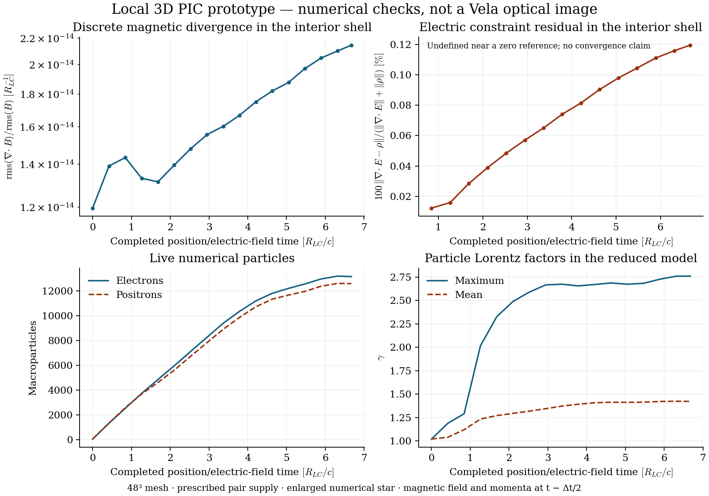

# Local oblique 3D pulsar PIC prototype

This is an original external problem generator for the pinned Entity relativistic particle-in-cell (PIC) code. Particle currents feed back into Maxwell's equations and the evolving fields act on both electrons and positrons. It is a **scaled numerical prototype**, with no Vela physical normalization, atmosphere calculation, optical radiation or claim of convergence

The pinned upstream Entity and Kokkos sources remain unchanged. Build dependencies and exact source pins are documented in [the PIC foundation check](../pic-benchmark/README.md). The problem generator intentionally uses the Serial CPU backend and no MPI or ADIOS2

## Reproduce

From the repository root, with CMake available:

```sh
python research/pic-local/run_local_pulsar.py --fetch --build --jobs 2 --cmake /absolute/path/to/cmake --run-dir outputs/my-local-pic-startup
```

The default input is `startup.toml`, a short startup of 0.8 code time units. `--fetch` is needed only when the exact pinned source checkouts are missing. If CMake is on PATH, omit `--cmake`. The builder uses an absolute external problem-generator path and a dedicated `third_party/entity-build-local-pulsar` build directory. It does not modify the upstream source or the earlier periodic benchmark build

After building, request approximately one integrated stellar turn, including the smooth spin-up, using a new output directory:

```sh
python research/pic-local/run_local_pulsar.py --config research/pic-local/one-rotation.toml --run-dir outputs/my-local-pic-one-turn
```

The runner refuses to reuse an existing run directory. It records the external source, input and binary hashes, source pins, commands, process result and exported state hashes. It also refuses a stale or unrecorded compiled problem-generator hash: use `--build` after any source edit

Repeated calculations may reuse an already verified compiled binary without repeating an upstream working-tree scan:

```sh
python research/pic-local/run_local_pulsar.py --reuse-verified-build outputs/my-local-pic-startup/verification.json --config research/pic-local/one-rotation.toml --run-dir outputs/my-local-pic-one-turn
```

The receipt must record a successful direct build from the exact pinned sources. The runner checks both the current executable bytes and the external problem-generator bytes against that receipt, refuses chained reuse receipts, and records the receipt hash in the new result. It does not claim to have freshly scanned upstream trees in this mode. The normal build route retains the clean-source checks

To reproduce the bounded feedback control, run the otherwise identical startup with particle current deposition disabled, then compare the saved fields:

```sh
python research/pic-local/run_local_pulsar.py --config research/pic-local/startup-no-feedback.toml --run-dir outputs/my-local-pic-control
python research/pic-local/compare_feedback.py outputs/my-local-pic-startup/native outputs/my-local-pic-control/native --step 38 --output outputs/my-local-pic-startup/feedback-comparison.json
```

In the recorded startup, the two initial field arrays were bit-identical and initial particle CSV hashes matched. At t = 0.7998706854, removing current feedback changed the measured interior electric-field L2 norm by 13.613% relative to the coupled result and the magnetic field by 4.852%. The control current was zero; the coupled current was nonzero. This demonstrates actual particle-to-field coupling; it is not an accuracy or convergence result

## Prescribed model and numerical scales

- Cartesian 48³ cells in a cube from −2.5 to +2.5 in each direction, with c = final Ω = R_LC = 1; Δx = 5/48 and Δt = 0.35 Δx/√3
- Stellar radius 0.5 R_LC, about 4.8 cells; light-cylinder radius about 9.6 cells. This is much larger relative to the light cylinder than the real Vela star
- Initial dipole inclination 75°, polar field 1 in normalized field units. This geometry is prescribed, not fitted to Vela
- Initial B is a compatible discrete curl of a finite vector potential A = μ×r f(r). Outside the star f = r⁻³; inside, f = [2.5 − 1.5(r/R)²]/R³. No singular dipole is sampled at the centre. Initial E = 0, and the initially injected pairs have exactly cancelling charges at matching positions
- A rigid interior conductor imposes E = −(Ω×r)×B on the staggered electric field inside the star. **B is never reset**. Its subsequent evolution is calculated by the native field solver, so the source magnetic moment may drift and must be measured
- Ω increases smoothly over T = 0.8: Ω(t) = Ω_final [3s² − 2s³], s = min(t/T,1). Its integrated phase is Ω_final T(s³ − s⁴/2) during spin-up and Ω_final(t − T/2) afterward
- `one-rotation.toml` requests 2π + T/2 time units. Runtime is rounded down to a whole number of native timesteps; use each state's recorded integrated spin phase rather than claiming an exactly completed turn
- Sixty-four neutral electron/positron pairs are injected per step, at matching positions on a Fibonacci-sampled spherical shell R + 0.7 Δx. Their prescribed velocities combine a radial 0.2c outflow and local corotation. These are imposed plasma-supply and loading assumptions, not a pair-cascade calculation or a physical thermal atmosphere
- Lorentz/Boris updates for electrons and positrons, masses 1 and charges −1/+1; no guiding-centre approximation. Reference skin depth 0.2, reference Larmor radius 0.05 and reference magnetization 16. These numerical scales are not Vela's microscopic scales
- Native current deposition and field feedback remain enabled; no current smoothing is applied. Particles entering the star are removed after their native current deposition. Neutral paired injection creates no net charge. Birth/death events retain stable species-counter IDs through native particle compaction
- Outer fields use Entity's `MATCH` layer toward zero fields over 0.5 code units; outer particles use `ABSORB` with a 0.2 layer. This damping prescription is not a proved reflection-free outgoing boundary and may introduce magnetic-divergence errors. The useful interior region must be assessed separately
- No gravity, neutron-star metric, ions, collisions, pair creation, radiation reaction, atmosphere radiative transfer or photon emission is included

## Raw export and exact staggering

Each state comprises `state-NNNNNN.json`, `state-NNNNNN-fields.bin` and `state-NNNNNN-particles.csv` in the run's `native/` directory. `events.csv` records births and deaths; `ledger.csv` records selected diagnostic totals. The initial state is also saved

The binary is little-endian float64 in C order `(i,j,k,component)`, including the ghost cells listed in the JSON. Its ten channels are:

1. Ex_U, Ey_U, Ez_U
2. Bx_U, By_U, Bz_U
3. Jx_U/ppc0, Jy_U/ppc0, Jz_U/ppc0, as left by native `CurrentsAmpere`
4. A separately deposited CIC **vertex** charge density in normalized Gauss-law units

Entity stores contravariant coordinate components. On this uniform Cartesian mesh, tetrad fields normalized by B0 are **Δx times the raw E_U or B_U**. Multiply once more by B0 to obtain the code's EM units. The current's normalized tetrad value in n0 units is Δx times the stored current; its source in the normalized electric-field equation additionally carries q0 n0/B0. Each JSON records B0, q0, n0 and V0. These are simulation normalizations, not assigned SI values for Vela

With active-grid vertex coordinate `(x_i,y_j,z_k)` and ghost offset g, the electric components and current components lie at:

- Ex/Jx: `(x_i + Δx/2, y_j, z_k)`
- Ey/Jy: `(x_i, y_j + Δx/2, z_k)`
- Ez/Jz: `(x_i, y_j, z_k + Δx/2)`

Magnetic components lie at:

- Bx: `(x_i, y_j + Δx/2, z_k + Δx/2)`
- By: `(x_i + Δx/2, y_j, z_k + Δx/2)`
- Bz: `(x_i + Δx/2, y_j + Δx/2, z_k)`

At a completed-step state, position and E are at the recorded time t; particle spatial proper velocities u = γv/c, B and the deposited current correspond to t − Δt/2. The initial B/u are interpreted at −Δt/2. Newly inserted momenta are prescribed on that associated half-step; no birth-time half-kick or physical thermalization calculation is performed. Do not treat all arrays as simultaneous camera data

The saved particle CSV contains live particles only: species, stable ID, physical code coordinates, ux/uy/uz and weight. `events.csv` separately identifies first appearance and star/boundary removal at the completed timestep; removal is not resolved to an exact substep crossing time. Species 1 is the electron and species 2 the positron

Entity's native subcell displacement type remains float32 even in its double-precision configuration. The exporter reconstructs coordinates by converting the integer cell index and stored fraction to double **before** adding them. Birth events use those actual stored coordinates as well. Thus the CSV retains the native stored state without introducing another float32 rounding of the full cell coordinate; it does not turn the native subcell storage into a higher-precision trajectory calculation

## Diagnostics and limits

The CIC vertex charge channel is `q0/(B0 V0) sum(q_sign weight S_CIC)`. Compare it with **backward differences of raw E_U**, without another division by Δx. Compatible magnetic divergence at cell centres uses **forward differences of raw B_U**, also without another division by Δx. These conventions account for the raw contravariant components; applying ordinary gradients to collocated-looking arrays gives the wrong diagnostic

The ledger's constraint RMS values are evaluated in the spherical region R_star + 3 Δx < r < 1.8. They do not certify the source staircase, damping layer, full-domain divergence or convergence. Independent auditing should compare particle charge, IDs/events, current feedback, source-moment drift and boundary contamination

The energy ledger separately records the electric-field change imposed by the conductor, injected particle energy and star/boundary particle losses. It is **not a complete conservation ledger**: electromagnetic boundary damping/Poynting flux and a properly synchronized Yee energy balance are not included. E and B are staggered in time. A small accounting residual alone must not be reported as conservation validation

None of these raw arrays constitute a visible-light prediction. A scientifically defensible Vela view additionally requires accepted kinetic convergence/scaling, observer-specific emission and absorption, light propagation and a physical stellar atmosphere model

## Measured results and unresolved limits

The corrected runs and file hashes are listed in [the evidence manifest](../../outputs/pic-local/native-results.json). The approximately one-turn case performs 317 steps, reaching commanded phase 6.27260545 rad, or 0.998316 turns. It is a startup transient rather than an established periodic state. The final live population is 25,735 numerical particles and the largest Lorentz factor is approximately 2.76

Independent raw-grid diagnostics measure `rms(div B)/rms(B) ≈ 2.14e−14 / R_LC` in the declared interior shell. The final symmetric Gauss residual `||div E − rho|| / (||div E|| + ||rho||)` is approximately 0.00120. These are discrete constraint measurements, not an accuracy or convergence certificate. Relative Gauss ratios are omitted when their reference is negligible compared with roundoff

The fitted **interior magnetic moment** changes in magnitude by about 7.94%, its inclination changes by about 1.05°, and its phase lags the commanded rotating direction by about 11.04°. The final dipole-family fit itself has a 14.9% residual. The field therefore cannot be described as an exactly maintained 75° rotating source. Measurable drift is present before an initial outer-layer adjustment can causally reach the star; later boundary influence is possible as well. Source size/resolution, staircase conductor, plasma loading and boundary effects have not been separated by controlled studies

The otherwise identical short control with particle deposition disabled changes the electromagnetic fields: the measured relative E/B differences in the documented region are about 13.6% and 4.85%, respectively. This demonstrates genuine particle-current feedback. It does not establish the accuracy of the kinetic population

The producer was corrected to promote integer cell indices before adding native float32 subcell offsets when reconstructing coordinates. Earlier CSV positions lost additional bits in that addition. Birth-event positions now describe the represented native coordinates. The independent charge audit recomputes first-order CIC vertex charge from the corrected CSVs and checks it against the separate native charge channel; failed older exports are preserved locally rather than relabeled as passes

Saved field snapshots are separated by 20 timesteps. They are diagnostics, not sufficiently resolved radiation trajectories: their cadence exceeds the cold reference gyroperiod at unit normalized field. No differentiation of these snapshots into an optical spectrum is justified. The dimensional [scale budget](../../outputs/pic-local/physical-scale-budget.json) also shows why assigning Vela's period alone cannot turn this enlarged numerical star and reduced fields into a physical Vela calculation

The next plasma steps are a controlled source/boundary accuracy repair, resolution/timestep/particle/loading sensitivity with matched injection rates, relaxation beyond startup, and a separately justified treatment of physical pair energies, pitch angles and radiation. The surface atmosphere requires its [own transfer calculation and opacity inputs](../ATMOSPHERE-SOLVER-PLAN.md). Additional numerical resolution by itself does not supply those missing physical ingredients



## Independent audits

```sh
python research/pic-local/audit_native.py outputs/my-local-pic-one-turn/native --output outputs/my-local-pic-one-turn/independent-audit.json
python research/pic-local/audit_charge.py outputs/my-local-pic-one-turn/native --require-match --output outputs/my-local-pic-one-turn/independent-charge-audit.json
python research/pic-local/audit_source.py outputs/my-local-pic-one-turn/native --output outputs/my-local-pic-one-turn/source-audit.json
python research/pic-local/physical_scale_budget.py --self-test
python research/pic-local/audit_charge.py --self-test
```

Raw binary fields, particle snapshots and birth/death event logs remain local to keep the Git package small; the exact inputs, compiled-source pins, metadata, raw-file hashes, ledgers, reports and reproduction instructions are included. The diagnostic plot can be regenerated from its small published `independent-audit.json` without downloading the raw arrays
